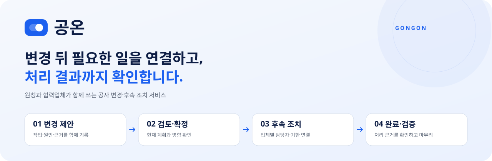
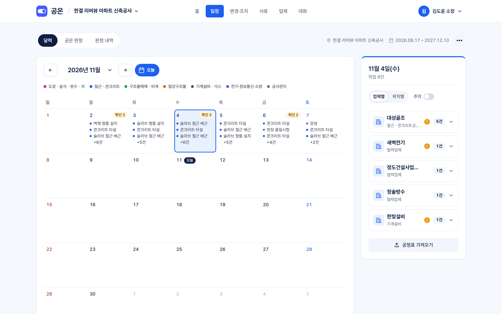
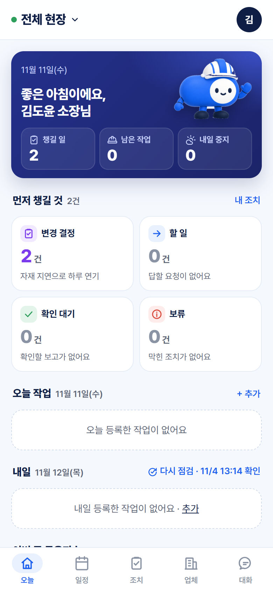

<div align="center">

[한국어](README.md) · **English**

**From a change in the construction plan to each contractor's action and proof of completion.**


[What it is](#what-is-gongon) · [Screens](#screens) · [Weather judgment](#weather-judgment-with-evidence) · [Getting started](#getting-started) · [Structure](#structure-and-checks) · [Contact](#contact)

</div>

---

## What is Gongon?

Gongon (공온, *gongsa* "construction" + ON) is a service for large construction sites that **connects the general contractor and subcontractors around the follow-up actions a work change requires**. It does not stop at moving a work slot: it records who has to do what by when, and the evidence that it was actually done.

Changes come from many causes — sequencing, labor, equipment, materials, drawings, quality, safety, weather and more. Weather is one of them. The weather judgment ships as an evidence module that compares forecasts against trade-specific criteria.

> [!NOTE]
> This is a non-commercial demo project. It was built from public sources and `[가상]` (fictional) cases with no real customer data. SMS verification and real KakaoTalk notifications are not connected. The app UI is in Korean.

## What happens after a change

| ① Propose change | ② Review impact · confirm | ③ Follow-up actions | ④ Report · verify |
| :---: | :---: | :---: | :---: |
| Record the changed work, its cause and evidence | Compare with the current plan and confirm a version | Link an owner, completion criteria and deadline | Submit proof of completion, then verify it |

- **Reading a message or editing the plan never counts as the action being done.** Delivery, read, response, completion report and verification are recorded separately.
- Proposer, approver, performer and verifier are distinct, and a change closes only when every required action is verified.
- A later change is a new version. Earlier records are kept, and completions do not carry over automatically.
- A record taken over the phone on someone's behalf is kept apart from a direct response by the person in charge.

## Screens

<p align="center">
  
  &nbsp;
  
</p>

<p align="center"><sub>PC web (Schedule) and phone app (Today). Fictional demo site.</sub></p>

PC and phone share one server and database; only the screens differ. The phone app is designed on its own rather than shrunk from the PC layout: the PC opens on a status board, the phone on your own to-do list.

| Menu | What you can do |
| --- | --- |
| **Home** | What to check first, today's schedule, tomorrow's outlook, 7-day Gongon Index |
| **Schedule** | Calendar and work entry (Excel schedule import), 7-day Gongon judgment table, judgment history |
| **Changes · Actions** | Propose, review and confirm changes; respond, hold, report and verify assigned actions |
| **Documents** | Daily construction report, weekly work plan, work disruption summary, draft work orders and site-condition reports (PC) |
| **Contractors** | Participating companies, contact roster and roles, join a site with a site code |
| **Chat** | Site-wide chat room. Attach photos, changes and actions, and propose a change straight from a message |
| **Site board** | Today's and tomorrow's work for a TV screen, no sign-up needed |

<details>
<summary><strong>Who uses it?</strong></summary>

| User | What they do |
| --- | --- |
| **GC site engineers / project admins** | Enter work, propose and confirm changes, assign actions, manage the contractor roster |
| GC safety and quality staff | Verify completion reports |
| Subcontractor site reps and foremen | Respond to assigned actions, report blockers and completion (phone) |
| Site manager · supervision · CM | View status |
| Workers and operators | See today's and tomorrow's work on the site board |

Only people who joined a site can see it. Roles and permissions are detailed in the [product summary](docs/product.md) and the [collaboration contract](docs/collab-contract.md) (Korean).

</details>

## Weather judgment with evidence

The four judgment levels keep their Korean names in the app.

| 진행 · Proceed | 확인 필요 · Needs check | 중지 검토 · Review stop | 판정 불가 · No judgment |
| :---: | :---: | :---: | :---: |
| A comparable forecast does not meet any criterion | The condition or forecast needs further checking | The forecast meets a stop-review criterion | The forecast needed for a judgment is missing |

- **Same input and same criteria version, same result.** There are no LLM calls or machine-learning judgments in the product.
- Forecast issue time, criteria version and hourly values are stored so every judgment can be traced. Forecasts for the same issue time and grid are reused across sites.
- Conditions a forecast cannot compare directly, such as gusts or road surface, are never raised to `중지 검토`; they stay as on-site checks. Missing values are never filled in as normal.
- **Gongon Index v2** is a rule-based reference score from 0 to 100. It does not express probability, safety or permission to work.

<details>
<summary><strong>Criteria and sources by trade</strong></summary>

| Trade | Criteria file | Main source |
| --- | --- | --- |
| Steel erection | [steel.yaml](rules/steel.yaml) | Occupational Safety and Health Standards Rules, Art. 383 |
| Concrete placement | [concrete.yaml](rules/concrete.yaml) | KCS 14 20 41 · 14 20 40, MOLIT rainfall guideline |
| Mobile crane · aerial work platform | [mobile_crane.yaml](rules/mobile_crane.yaml) · [aerial_platform.yaml](rules/aerial_platform.yaml) | Safety Rules Art. 37, strong-wind advisory criteria, Art. 383 applied by analogy |
| Painting · waterproofing | [paint_waterproof.yaml](rules/paint_waterproof.yaml) | KCS 41 47 00 · 41 40 01 |
| Asphalt paving | [asphalt_paving.yaml](rules/asphalt_paving.yaml) | KCS 44 50 10 |
| Heat wave (all trades) | [heat.yaml](rules/heat.yaml) | Safety Rules Art. 559–560 |

Source excerpts are kept in [rules/sources](rules/sources) and checked by the [source comparison test](tests/engine/judgment/test_rule_sources.py). Statutory criteria are kept apart from criteria the product applies by analogy.

</details>

## Getting started

**Requirements:** Python 3.12 · [uv](https://docs.astral.sh/uv/) · PostgreSQL 17. The full setup, including database creation and API keys, is in the [setup guide](docs/setup.md) (Korean).

```bash
uv sync --locked
cp .env.example .env
```

Create a `gongon` database for development and a `gongon_test` database for tests, then fill in `.env`. Keys and account values are never committed.

| Environment variable | Purpose |
| --- | --- |
| `DATABASE_URL` · `TEST_DATABASE_URL` | Development and test PostgreSQL connections |
| `KMA_SERVICE_KEY` · `KMA_APIHUB_KEY` | Korea Meteorological Administration forecasts (either one). Without a key, judgments are recorded as `판정 불가` |
| `KAKAO_REST_API_KEY` | Address → coordinates (optional; coordinates can be entered directly) |
| `AUTO_REFRESH=0` | Turn off the hourly automatic judgment |

```bash
uv run python -m alembic upgrade head
uv run python scripts/serve.py
```

| Address | Screen |
| --- | --- |
| http://127.0.0.1:8000 | PC web (service site → sign in → site) |
| http://127.0.0.1:8100/static/phone.html | Phone app preview (390×844 frame) |

Create the fictional demo site and accounts with `uv run python scripts/seed_demo.py`. On Windows, `scripts/start.bat` checks PostgreSQL, applies migrations, starts both servers and opens the windows in one step.

## Structure and checks

```text
app/features/   per-feature API · logic · DB access · screens
app/core/       shared settings · auth boundary · templates · styles
engine/         forecast normalization · location conversion · rule-based judgment
rules/          criteria by trade and official source excerpts
migrations/     database change history
scripts/        run · check · demo data · source collection
tests/          features · permissions · boundaries · duplicate-run checks
design/figma/   scripts that draw the Figma web and app screens
docs/           requirements · contracts · decisions · handoff
```

Dependencies point one way, `app → engine`. Judgment and location code run without a database, HTTP or the web, and features call each other only through `service` and `schemas`. The [import boundary test](tests/test_import_boundaries.py) enforces this.

```bash
uv run python scripts/check.py
```

This runs the same ruff · format · mypy · pytest checks as CI. External APIs are swapped for fake adapters, so tests need no network or outside accounts. Database tests need `TEST_DATABASE_URL`.

| Document (Korean) | Contents |
| --- | --- |
| [Product summary](docs/product.md) | What is built, and for whom |
| [Collaboration contract](docs/collab-contract.md) · [Judgment contract](docs/contract.md) | Permissions and state transitions, judgment storage format |
| [Architecture](docs/architecture.md) · [Setup guide](docs/setup.md) | Code layout and dependency rules, environment setup |
| [Decision log](docs/decisions.md) | Choices made and why |
| [Brand](docs/brand.md) | Screen wording and visual standards |

## Contact

Questions and suggestions are welcome.

| | |
| --- | --- |
| Email | [sim39422@gmail.com](mailto:sim39422@gmail.com) |
| GitHub | [github.com/jeon9hy](https://github.com/jeon9hy) |

---

<div align="center">
<sub>The site manager makes the final call. Gongon's judgments are rule-based reference information and do not replace work permits, official inspections or safety assurance.</sub>
</div>
