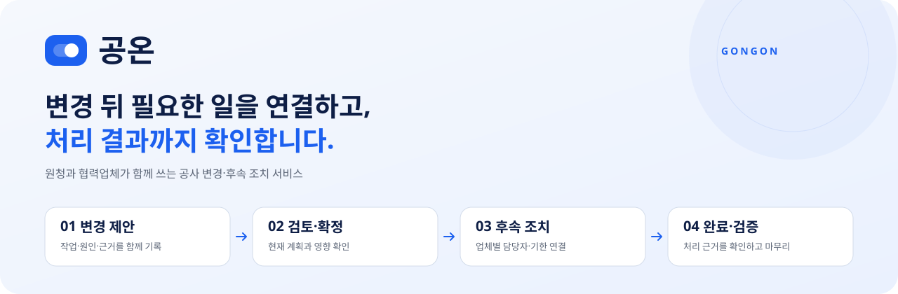
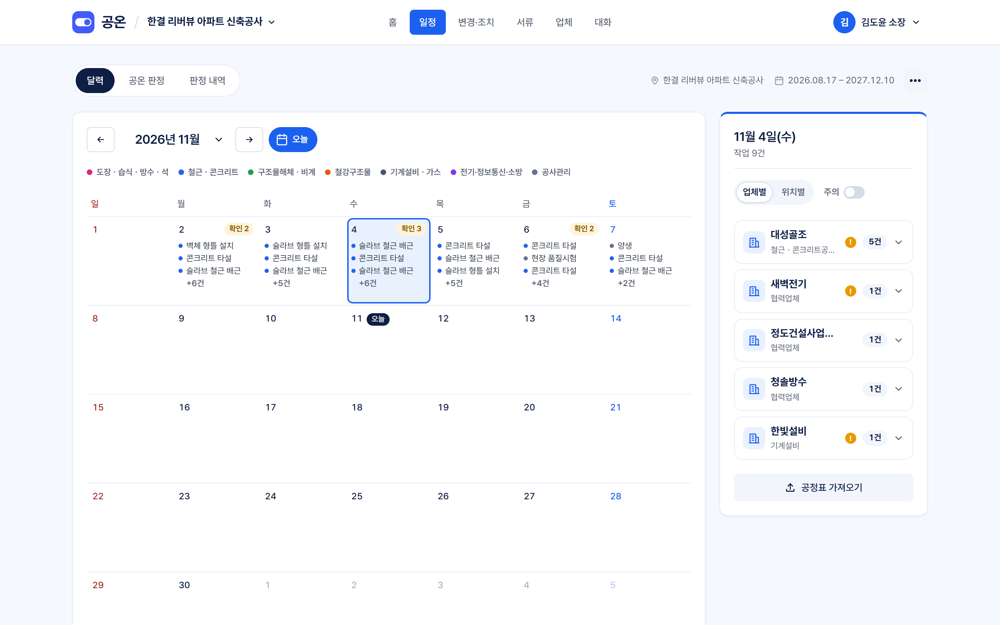
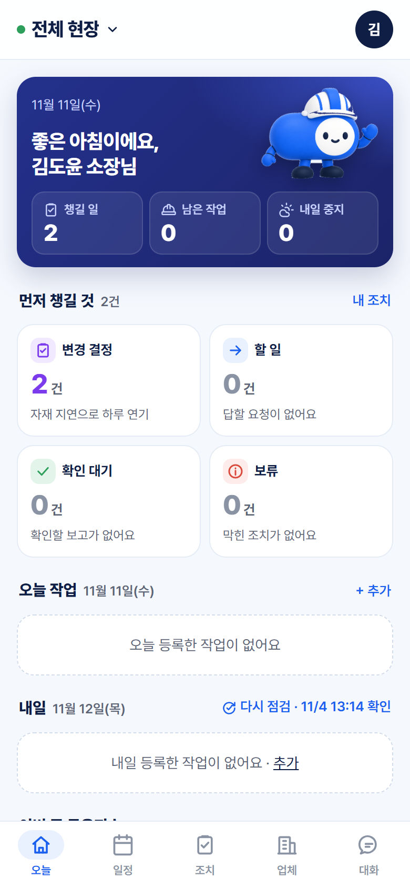

<div align="center">

**한국어** · [English](README.en.md)

**공사 계획의 변경부터, 업체별 조치와 완료 근거까지.**


[어떤 서비스인가요](#어떤-서비스인가요) · [화면](#화면) · [기상 판정](#기상-판정은-근거와-함께) · [시작하기](#시작하기) · [구조](#구조와-검증) · [문의](#문의)

</div>

---

## 어떤 서비스인가요?

공온은 대형 건설 현장에서 **원청과 협력업체의 작업 변경 후속 조치를 연결하는 서비스**입니다. 작업 시간을 바꾸는 데서 그치지 않고, 누가 무엇을 언제까지 처리해야 하는지와 실제 처리 근거를 함께 남깁니다.

변경의 원인은 공정·인력·장비·자재·도면·품질·안전·기상 등 여러 가지이고, 날씨는 그중 하나입니다. 기상 판정은 공종별 기준과 예보를 대조하는 근거 모듈로 들어 있습니다.

> [!NOTE]
> 비상업 시연 프로젝트입니다. 실제 고객 자료 없이 공개 자료와 `[가상]` 사례로 만들었고, 문자 인증과 카카오톡 알림 실발송은 연결하지 않았습니다.

## 변경 뒤, 이렇게 이어집니다

| ① 변경 제안 | ② 영향 검토·확정 | ③ 후속 조치 | ④ 완료 보고·검증 |
| :---: | :---: | :---: | :---: |
| 바뀐 작업과 원인·근거 기록 | 현재 계획과 비교하고 버전 확정 | 담당자·완료 기준·기한 연결 | 처리 근거 제출 후 검증 |

- **메시지를 읽거나 계획을 고친 것만으로 조치가 끝났다고 처리하지 않습니다.** 전송·열람·응답·완료 보고·검증을 따로 기록합니다.
- 제안자·확정자·수행자·검증자를 구분하고, 필수 조치가 모두 검증되어야 변경 건이 닫힙니다.
- 다시 바뀌면 새 버전입니다. 이전 기록은 보존하고 완료를 자동으로 넘겨받지 않습니다.
- 전화로 확인한 대리 기록과 담당자의 직접 응답을 구분합니다.

## 화면

<p align="center">
  
  &nbsp;
  
</p>

<p align="center"><sub>PC 웹(일정)과 휴대폰 앱(오늘). 시연용 가상 현장입니다.</sub></p>

PC와 휴대폰은 서버·DB가 같고 화면만 다릅니다. 휴대폰은 PC 화면을 줄인 것이 아니라 따로 설계했습니다. PC 첫 화면은 현황판, 휴대폰 첫 화면은 내 할 일입니다.

| 메뉴 | 할 수 있는 일 |
| --- | --- |
| **홈** | 먼저 확인할 일, 오늘 일정, 내일 작업 전망, 7일 공온지수 |
| **일정** | 달력·작업 등록(공정표 엑셀 가져오기), 공온 판정 7일 표, 판정 내역 |
| **변경·조치** | 변경 건 제안·검토·확정, 맡은 조치 응답·보류·완료 보고·검증 |
| **서류** | 공사일보, 주간 작업계획표, 작업 차질 집계, 작업 지시서·실정보고 초안(PC) |
| **업체** | 참여 업체·담당자 명부·역할, 현장 코드로 참여 |
| **대화** | 현장 참여자 대화방. 사진·변경 건·조치를 붙이고 메시지에서 바로 변경 제안 |
| **현장 게시 화면** | 가입 없이 보는 오늘·내일 작업(TV용) |

<details>
<summary><strong>누가 쓰나요?</strong></summary>

| 사용자 | 하는 일 |
| --- | --- |
| **원청 공사·공무 담당자** | 작업 등록, 변경 제안·확정, 조치 배정, 업체 명부 관리 |
| 원청 안전·품질 담당 | 완료 보고 검증 |
| 협력업체 현장대리인·반장 | 맡은 조치 응답·막힘·완료 보고(휴대폰) |
| 소장 · 감리 · CM | 현황 보기 |
| 작업자·기사 | 현장 게시 화면으로 오늘·내일 작업 보기 |

현장에 참여한 사람만 그 현장을 볼 수 있습니다. 자세한 역할과 권한은 [제품 요약](docs/product.md)과 [협업 계약](docs/collab-contract.md)에 있습니다.

</details>

## 기상 판정은 근거와 함께

| 진행 | 확인 필요 | 중지 검토 | 판정 불가 |
| :---: | :---: | :---: | :---: |
| 비교 가능한 예보가 기준에 해당하지 않음 | 조건·예보의 추가 확인 필요 | 예보가 중지 검토 기준에 해당 | 판정에 필요한 예보가 없음 |

- **같은 입력·같은 기준 버전이면 같은 결과.** 제품에 LLM 호출이나 머신러닝 판정은 없습니다.
- 예보 발표 시각·기준 버전·시간별 값을 저장해 판정 근거를 확인할 수 있습니다. 같은 발표 시각·격자의 예보는 현장끼리 재사용합니다.
- 예보로 직접 비교하지 못하는 순간풍속·노면 상태 등은 `중지 검토`로 올리지 않고 현장 확인 대상으로 남깁니다. 누락 값을 정상값으로 채우지 않습니다.
- **공온지수 v2**는 0~100의 규칙 기반 참고 점수입니다. 확률·안전도·작업 허가를 뜻하지 않습니다.

<details>
<summary><strong>공종별 기준과 출처</strong></summary>

| 공종 | 기준 파일 | 주요 출처 |
| --- | --- | --- |
| 철골 작업 | [steel.yaml](rules/steel.yaml) | 산업안전보건기준에 관한 규칙 제383조 |
| 콘크리트 타설 | [concrete.yaml](rules/concrete.yaml) | KCS 14 20 41·14 20 40, 국토교통부 강우 지침 |
| 이동식 크레인·고소작업대 | [mobile_crane.yaml](rules/mobile_crane.yaml) · [aerial_platform.yaml](rules/aerial_platform.yaml) | 안전보건규칙 제37조, 강풍주의보 기준, 제383조 준용 |
| 도장·방수 | [paint_waterproof.yaml](rules/paint_waterproof.yaml) | KCS 41 47 00·41 40 01 |
| 아스팔트 포장 | [asphalt_paving.yaml](rules/asphalt_paving.yaml) | KCS 44 50 10 |
| 폭염(공통) | [heat.yaml](rules/heat.yaml) | 안전보건규칙 제559~560조 |

원문 발췌는 [rules/sources](rules/sources)에 보존하고 [원문 대조 테스트](tests/engine/judgment/test_rule_sources.py)로 확인합니다. 법정 기준과 제품에서 준용한 기준을 구분합니다.

</details>

## 시작하기

**준비물:** Python 3.12 · [uv](https://docs.astral.sh/uv/) · PostgreSQL 17. DB 만들기와 키 발급까지의 전체 절차는 [실행 가이드](docs/setup.md)에 있습니다.

```bash
uv sync --locked
cp .env.example .env
```

개발용 `gongon`과 테스트용 `gongon_test` DB를 만들고 `.env`를 채웁니다. 키와 계정 값은 Git에 올리지 않습니다.

| 환경 변수 | 용도 |
| --- | --- |
| `DATABASE_URL` · `TEST_DATABASE_URL` | 개발·테스트 PostgreSQL 연결 |
| `KMA_SERVICE_KEY` · `KMA_APIHUB_KEY` | 기상청 예보 수집(둘 중 하나). 없으면 판정이 `판정 불가`로 기록됩니다 |
| `KAKAO_REST_API_KEY` | 주소 → 좌표 변환(선택, 좌표 직접 입력 가능) |
| `AUTO_REFRESH=0` | 매시 자동 판정 끄기 |

```bash
uv run python -m alembic upgrade head
uv run python scripts/serve.py
```

| 주소 | 화면 |
| --- | --- |
| http://127.0.0.1:8000 | PC 웹 (서비스 사이트 → 로그인 → 현장) |
| http://127.0.0.1:8100/static/phone.html | 휴대폰 앱 미리보기(390×844 틀) |

가상 현장과 시연 계정은 `uv run python scripts/seed_demo.py`로 만듭니다. Windows에서는 `scripts/start.bat` 하나로 PostgreSQL 확인·마이그레이션·서버 실행·창 열기까지 합니다.

## 구조와 검증

```text
app/features/   기능별 API · 처리 · DB 접근 · 화면
app/core/       공통 설정 · 인증 경계 · 템플릿 · 스타일
engine/         예보 정규화 · 위치 변환 · 규칙 기반 판정
rules/          공종별 기준표와 공식 원문 발췌
migrations/     DB 변경 이력
scripts/        실행 · 검증 · 시연 자료 · 원문 수집
tests/          기능 · 권한 · 경계 · 중복 실행 검증
design/figma/   Figma 웹·앱 화면을 그리는 스크립트
docs/           요구사항 · 계약 · 결정 · 작업 인계
```

의존성은 `app → engine` 한 방향입니다. 판정·위치 계산은 DB·HTTP·웹 없이 동작하고, 기능끼리는 `service`·`schemas`로만 부릅니다. [폴더 경계 테스트](tests/test_import_boundaries.py)가 이를 강제합니다.

```bash
uv run python scripts/check.py
```

CI와 같은 ruff · 포맷 · mypy · pytest 검사입니다. 외부 API는 가짜 어댑터로 바꾸므로 실제 네트워크나 외부 계정 없이 돕니다. DB 테스트에는 `TEST_DATABASE_URL`이 필요합니다.

| 문서 | 내용 |
| --- | --- |
| [제품 요약](docs/product.md) | 무엇을 누구를 위해 만드는지 |
| [협업 계약](docs/collab-contract.md) · [판정 계약](docs/contract.md) | 권한·상태 전이, 판정 저장 형식 |
| [구조](docs/architecture.md) · [실행 가이드](docs/setup.md) | 코드 위치와 의존 규칙, 환경 설정 |
| [결정 기록](docs/decisions.md) | 확정한 선택과 그 이유 |
| [브랜드](docs/brand.md) | 화면 문구와 시각 기준 |

## 문의

궁금한 점이나 제안은 아래로 보내 주세요.

| | |
| --- | --- |
| 이메일 | [sim5213@naver.com](mailto:sim5213@naver.com) |
| GitHub | [github.com/jeon9hy](https://github.com/jeon9hy) |

---

<div align="center">
<sub>최종 판단은 현장 책임자가 합니다. 공온 판정은 규칙 기반 참고 정보이며 작업 허가·공식 검측·안전 보장을 대신하지 않습니다.</sub>
</div>
