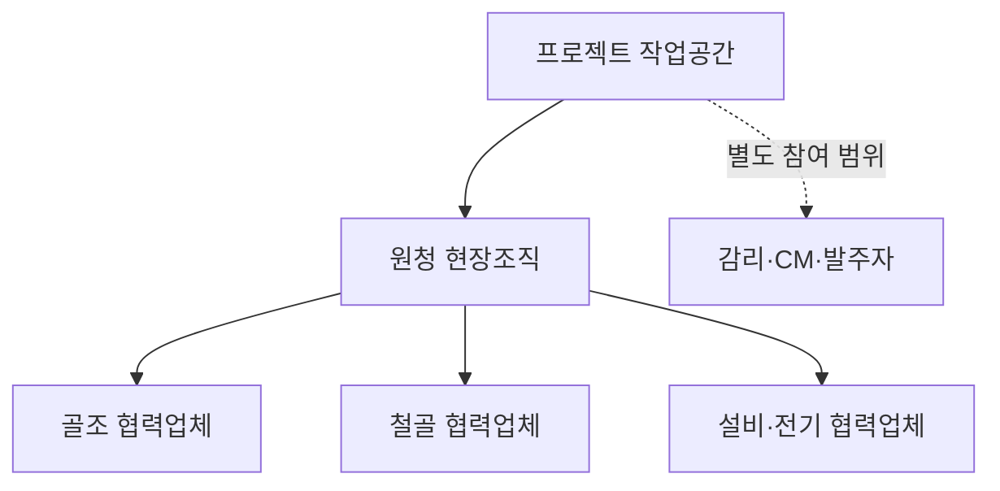

# 공온 작업 변경 후속 조치 플랫폼 개발기획서

대형 건설사 원청과 협력업체가 작업 변경 이후의 일을 끝까지 연결하는 서비스

작성 2026년 10월 16일 | 기획 v2.1 | 제품 재기획·개발 기준 동기화 | 신규 기능 구현 전

## 01 이것만 읽으면 되는 제품 설명

**공온은 공사 계획이 바뀌었을 때, 함께 바꿔야 하는 일을 관련 업체와 담당자에게 연결하고 실제로 처리됐는지 확인하는 서비스다.** 첫 고객은 대형 건설사의 현장 조직이다. 원청 프로젝트 안에 협력업체가 참여하고, 각 회사 담당자가 자신의 조치를 처리한다.

예를 들어 내일 타설을 연기했다면 공정표 수정만으로 끝나지 않는다. 레미콘 출하, 펌프카 예약, 작업조 출역, 검측 요청, 뒤에 이어질 작업도 확인해야 한다. 공온은 이 일을 하나의 변경 건으로 묶고 **누가, 언제까지, 무엇을 바꿔야 하는지와 처리 근거**를 남긴다. 아래 사례는 설명용 가상 사례다.

기상은 변경 사유 중 하나다. 도면 수정, 자재 지연, 장비 고장, 인력 부족, 검측 지연, 안전 문제, 작업 구역 충돌, 비용·계약 조건도 같은 흐름에 들어온다. 모든 요인을 자동 판단하는 기능을 먼저 만들지는 않는다. 어떤 이유로 바뀌든 후속 조치를 놓치지 않는 공통 흐름부터 만든다.

### 읽는 순서

- 사업 방향과 경쟁력 판단: 01~05장. 첫 고객·문제·경쟁 제품과 검증 가설을 설명한다.
- 사용 화면과 업무 흐름: 06~10장. 사용자와 개발자가 함께 확인한다.
- 클로드 코드·Codex 구현 참고: 11~17장. 요구사항의 기준은 저장소의 서비스_개발_총정리.md, 현재 작업은 docs/plan.md다.
- 현장 검증과 다음 행동: 18~20장. 기능을 늘리기 전에 무엇을 확인할지 정한다.

이 문서는 v1.0의 포괄적인 ‘현장 의사결정 플랫폼’을 대체한다. 시장 수요·비용 절감·고객 확보가 입증됐다는 뜻은 아니다. 이번 결과물은 재기획과 개발 문서이며, 서비스 화면·DB·인증 기능을 새로 구현한 결과가 아니다.

<!-- page -->

## 02 왜 이 문제에 집중하는가

가설은 **변경을 결정하는 일과, 그 결정에 맞춰 여러 회사가 실제 행동을 바꾸는 일 사이에 반복적인 확인 업무가 있다**는 것이다. 이 간격이 충분히 크고 기존 도구로 해결하기 번거로워야 공온을 도입할 이유가 생긴다. 아직 현장 인터뷰로 확인하지 않았다.

| 현재 발생할 수 있는 상황 | 공온이 제공할 결과 |
| --- | --- |
| 단체방에서 연기를 공지했지만 장비 예약 변경은 미확인 | 공지 열람과 예약 변경 완료를 각각 표시 |
| 서로 다른 회사가 같은 변경을 따로 기록 | 하나의 변경 번호와 버전으로 각 조치를 연결 |
| 누군가는 예전 일정에 따라 출동 | 최신 변경의 대상자와 이전 버전 처리 내역을 비교 |
| 현장 담당자가 업체마다 다시 전화 | 미응답·막힘·검증 대기인 조치만 모아 확인 |
| 나중에 무엇을 바꿨는지 재구성 | 변경 전후, 담당자, 연락·실행·검증 시각을 연결 |

### 제품의 중심 단위

**예정 작업 → 변경 건 → 확정한 변경 버전 → 후속 조치 → 완료 보고·근거 → 담당자의 검증**

작업은 무엇을 할 계획인지, 변경 건은 왜 무엇이 달라지는지, 후속 조치는 각 회사가 어떤 행동을 해야 하는지를 뜻한다. ‘알림을 보냈다’와 ‘상대방이 실제로 처리했다’는 서로 다른 사실이다.

담당자가 검토한 필수 조치가 모두 검증된 경우에만 해당 버전의 처리 종료를 요청할 수 있다. 종료는 등록된 조치의 처리 상태를 뜻한다. 현장의 모든 영향이 빠짐없이 발견됐거나 작업의 안전·품질·계약 적합성이 보장됐다는 의미가 아니다.

<!-- page -->

## 03 첫 고객과 도입 구조

목표 고객은 대형 건설사다. 첫 시험 범위는 **한 프로젝트의 작업 변경 업무 한 종류**로 좁힌다. 고객 규모를 중소 업체로 바꾸지 않고, 한 번에 검증할 업무를 작게 정한다. 타설 일정 변경은 예시이며, 실제 사례 접근성과 불편을 확인해 작업을 선택한다.

| 참여자 | 공온을 사용하는 이유 | 도입 때 확인할 것 |
| --- | --- | --- |
| 원청 공사 담당·공정 조정자 | 변경의 영향 업체와 남은 조치를 확인 | 현재 연락 방식, 업무 추가 여부 |
| 현장소장·공사 책임자 | 위임 범위에 따라 변경 판단·미처리 사안 조정 | 실제 전결 기준·긴급 보고 경로 |
| 협력업체 소장·반장 | 출역·장비·자재 등의 조치를 받고 처리 | 회사별 책임자·대체 담당자 |
| 품질·안전·공무 담당 | 자신의 검토·검측·비용 관련 조치 확인 | 어떤 변경에서 참여해야 하는지 |
| 본사 도입·보안·구매 담당 | 시스템·정보 관리·계약 검토 | 예산 주체, 사내 도입 절차 |
| 감리·CM·발주자 | 해당 계약에서 요청받은 협의·검토에 참여 | 별도 참여 권한과 공식 승인 경로 |

제품을 자주 쓰는 사람, 도입을 제안하는 사람, 돈을 지불하는 사람은 다를 수 있다. 현장 담당자의 호평만으로 구매가 성립했다고 판단하지 않는다. 회사별 조직명과 전결 권한은 고객에게 확인한다. 모든 대형 건설사에 같은 승인 구조를 강제하지 않는다.

가입을 늘리기 위해 모든 작업자·장비 기사에게 설치를 요구하지 않는다. 처음에는 책임 담당자가 전화 확인 내용을 출처와 함께 기록할 수 있게 한다. 직접 참여한 사용자의 응답과 대신 적은 연락 기록은 구분한다.

<!-- page -->

## 04 경쟁 제품과 정직하게 비교하기

**담당자·기한·증빙을 붙이는 것 자체는 차별점이 아니다.** Procore Action Plans는 담당자, 기한, 필수 서명, 진행 차단, 완료 근거와 검토를 제공한다.[1] 콘업은 시공자·감리자·협력업체가 자료와 공사 기록을 공유하는 협업 제품을 제공한다.[2] Touchplan은 협업 계획과 약속 이행을 다룬다.[3]

| 비교 대상 | 이미 제공하는 기능 범위 | 공온이 실증해야 할 질문 |
| --- | --- | --- |
| Procore Action Plans | 담당·기한·검증·완료 증빙 | 작업 변경 시 회사 밖 예약·출역까지 더 적은 입력으로 연결하나? |
| 콘업 | 도면·기록·현장 협업 | 실제 변경 업무에서 별도 공온이 필요한 빈틈이 있나? |
| Touchplan | 협업 공정 계획·약속 관리 | 변경 후 조치까지 기존 운영으로 충분히 관리 가능한가? |
| PMIS·엑셀·전화·단체방 | 현장이 이미 익숙한 업무 조합 | 공온 입력까지 합친 총 확인 시간이 줄어드나? |

공개 설명만 보고 경쟁 제품에 어떤 기능이 없다고 단정하지 않는다. 같은 실제 변경 사례를 기존 제품의 설정·업무 방식과 공온 시제품으로 각각 재현해 비교한다. 콘업·Procore와 모든 기능을 맞추려는 개발은 하지 않는다.

### 도입을 정당화할 차별화 가설

**변경 종류별로 필요한 후속 조치를 빠르게 꺼내고, 회사마다 다른 처리 방식을 연결하며, 재변경으로 예전 조치가 남는 문제를 줄인다.** 예약 확인 번호·전화 회신 등 현실의 처리 근거를 최소 입력으로 남기고, 기존 공정표·PMIS의 작업 번호를 이어 쓴다.

이 가설을 기존 제품의 간단한 설정으로 같은 비용에 충족할 수 있다면 독립 플랫폼 개발 범위를 축소하거나 해당 제품을 보완하는 방식으로 바꾼다. 현재 경쟁력 평가는 ‘검증할 만한 문제 가설’이며, 입증된 시장 우위가 아니다. 출처 확인일은 2026-10-16이다.

<!-- page -->

## 05 첫 상품과 이후 확장

| 구분 | 범위 | 진입 조건 |
| --- | --- | --- |
| 첫 상품 | 작업 변경·회사별 후속 조치·기한·완료 근거·검증·재변경 | 공개 조사·합성 사례·구현 계약 |
| 다음 후보 | 도면·승인 자료가 바뀌었을 때 관련 조치의 재검토 요청 | 자료 버전과 조치 연결 수요 확인 |
| 이후 후보 | 현장 간 장비·자원 반출 가능 시점과 배치 조정 | 여러 현장의 권한·가용 상태·승인 확인 |

첫 상품에는 계정·프로젝트 참여, 작업 참조, 변경 등록·확정, 필수 조치 지정, 담당자 응답, 완료 보고·검증, 미처리 목록, 변경 버전 이력이 필요하다. 정해진 양식 하나의 작업 목록 가져오기는 실제 양식을 확인한 뒤 선택한다. 전체 PMIS 동기화를 첫 출시 조건으로 두지 않는다.

다음 후보의 ‘재검토 요청’은 승인 취소가 아니다. 도면이 바뀌었다는 이유로 기존의 법적·계약상 승인을 공온이 자동 무효화하지 않는다. 현장 간 연결도 첫 상품의 필수 기능이 아니다. 자원 중개시장부터 만들면 수요·공급 확보와 실제 가용성 확인이 추가로 필요하다.

### 기상의 위치

기상 판정 엔진과 예보 자료는 유지한다. 변경의 원인·검토 근거로 연결할 수 있다. 그러나 작업 변경을 만들기 위해 기상 판정이 먼저 있어야 하는 구조는 쓰지 않는다. 새 고객 화면의 첫 질문은 **“변경 뒤 아직 처리되지 않은 일은 무엇인가?”**다.

계약·도면·안전·품질 전체를 자동 판단하거나 공정 전체를 최적화하는 제품으로 넓히는 일은 후속 수요가 확인된 뒤 별도 기획한다. 이번 MVP에는 제품 내 LLM, 자동 예약 취소·발주, 인력 매칭·결제, 일반 채팅, 공사비 자동 승인, 새 종합 점수가 없다.

<!-- page -->

## 06 원청 아래 협력업체가 참여하는 방식

원청 아래 업체가 보이는 구조는 프로젝트의 참여 관계다. 회사의 소유 관계나 모든 정보에 대한 열람 권한을 뜻하지 않는다. 감리·CM·발주자는 협력업체 아래에 강제로 넣지 않고 계약상 역할에 맞게 별도로 초대한다.

| 범위 | 적용 원칙 |
| --- | --- |
| 프로젝트 | 초대·참여 승인된 프로젝트만 접근 |
| 회사 | 같은 회사 소속이어도 모든 프로젝트를 자동 열람하지 않음 |
| 변경·조치 | 업무 조정자는 허용 범위 전체, 업체 담당자는 관련 건만 확인 |
| 민감 자료 | 다른 업체 단가·계약·비공개 첨부는 별도 범위로 제한 |
| 작업자·기사 | 자신의 실행에 필요한 시간·장소·변경 사항만 제공 |
| 대체 담당자 | 위임 범위·기간·실제 처리자를 기록 |

변경 제안자, 확정 권한자, 조치 수행자, 검증자를 구분한다. 안전 담당자에게 모든 공정 변경을 최종 승인하게 하거나 현장소장에게 모든 단순 연락을 결재하게 만들지 않는다. 프로젝트에서 정한 권한과 예외 경로를 적용한다.

다중 업체의 실제 자료를 받기 전에 서버의 인증·프로젝트·업체별 접근 통제가 선행한다. 링크를 안다는 이유만으로 변경·첨부를 열 수 없게 한다.

<!-- page -->

## 07 가상 사례로 보는 사용 흐름

가정: A현장의 다음 날 09시 타설을 모레 10시로 바꾸는 상황이다. 원인은 자재 지연으로 놓는다. 같은 흐름에 기상·도면·안전 등의 사유를 넣을 수 있다. 아래 기한과 조치 목록은 현장 표준이 아닌 설명용 예시다.

| 단계 | 담당자의 행동 | 남기는 기록 |
| --- | --- | --- |
| 제안 | 원청 공사 담당자가 변경 전후·사유 등록 | 작업·구역·현재 버전·근거 |
| 영향 확인 | 골조 업체·장비·품질·후속 공정 담당과 확인 | 추가할 조치와 미확인 영향 |
| 확정 | 지정된 권한자가 변경 내용과 필수 조치 확정 | 확정자·시각·변경 버전 |
| 전달·응답 | 각 담당자가 내용을 보고 수락 또는 막힘 보고 | 대상 버전·응답·사유 |
| 실제 처리 | 업체별로 예약·출역·검측 요청 변경 | 처리 시각·회신·참조 번호 |
| 검증·종료 | 지정 담당자가 근거와 대상 버전 확인 | 검증자·결과·미해결 사항 |

### 이 변경에 붙는 후속 조치 예

- 골조 업체 담당: 레미콘 출하 일정 변경을 공급사와 확인한다.
- 장비 담당: 펌프카 예약 변경을 확인한다.
- 협력업체 반장: 작업조 출역 계획을 수정한다.
- 품질 담당: 검측 요청 시간 변경 또는 재요청을 확인한다.
- 후속 공정 담당: 영향을 받은 작업을 검토하고 필요한 조치를 추가한다.

템플릿이 이 목록을 제안하더라도 담당자가 누락·불필요 항목을 확인한다. 공온에서 일정이 확정됐다는 이유만으로 공급사의 예약이 바뀌었다고 표시하지 않는다. 예약 시스템과 실제 연동되지 않았다면 담당자의 처리와 확인 기록이 필요하다.

<!-- page -->

## 08 모든 공사 요인을 담는 방법

요인은 변경의 사유·근거·영향을 설명하는 항목이다. 매 작업마다 모든 분야를 입력하게 하지 않는다. 선택한 변경에 관련된 요인만 연결하며, 여러 요인이 함께 작용하면 복수 선택한다.

| 요인 | 변경 사례 | 후속 조치 후보 |
| --- | --- | --- |
| 공정·선행 작업 | 선행 작업 미완료 | 후속 일정·작업조 협의 |
| 인력 | 숙련 작업조 출역 변경 | 업체 배치·대체 가능 여부 확인 |
| 장비 | 고장·예약 충돌 | 정비·대체 예약·반입 시간 확인 |
| 자재 | 납기 지연·규격 변경 | 발주·반입·보관·재검측 확인 |
| 도면·설계 | 시공 도면 개정 | 영향 구역·작업·재검토 요청 확인 |
| 품질·검측 | 검측 보완 요구 | 보완·검측 재요청·후속 착수 검토 |
| 안전·작업 허가 | 위험 발견·조건 미확인 | 현장 조치·보고·재개 절차 확인 |
| 구역·동선 | 양중·반입 동선 충돌 | 구역·시간·유도 계획 조정 |
| 비용·계약 | 변경 비용 협의 필요 | 공무 검토 요청·공식 문서 참조 |
| 외부 조건 | 인허가·민원·반입 제한 | 관계 담당자 확인·일정 협의 |
| 기상 | 강우·폭염·강풍 영향 | 현장 확인·일정 및 자원 조정 |

이 표는 인터뷰용 분류 초안이다. 작업 허가·검측·계약 변경의 법적 절차를 정의한 표가 아니다. 근거가 없는 수치나 업체별 취소 마감은 기본값으로 만들지 않는다.

긴급 위험 발견 시 필요한 현장 대응을 공온 입력이나 일반 변경 결재가 끝날 때까지 기다리는 흐름으로 만들지 않는다. 현장 대응 후 담당자가 경위·관련 조치를 기록할 수 있게 하며, 구체적 보고·재개 경로는 고객의 확인된 절차를 따른다.

<!-- page -->

## 09 상태와 종료 조건

변경 건의 상태는 **초안 → 영향 검토 → 확정·조치 중 → 종료 검토 → 종료**로 제안한다. 확정 전에는 철회할 수 있다. 확정 후 취소·재변경은 새 버전과 필요한 되돌림 조치를 남긴다. 상태 이름은 C02에서 계약으로 확정한다.

| 기록 | 뜻 | 다음 상태와의 차이 |
| --- | --- | --- |
| 전송 성공 | 전달 수단이 요청을 수락 | 상대방의 열람을 증명하지 않음 |
| 열람 | 해당 버전을 사용자가 열어봄 | 수락·예약 변경을 뜻하지 않음 |
| 응답 | 담당자가 수행 수락·막힘을 보고 | 실제 조치 완료와 구분 |
| 완료 보고 | 수행자가 처리 내용과 근거 제출 | 검증자가 확인하기 전 |
| 검증 완료 | 지정 검증자가 해당 조치의 근거 확인 | 법적 승인·현장 전체 적합성 보증 아님 |

조치의 기본 흐름은 요청 대기·수행 중·완료 보고·검증 완료다. 막힘은 별도 표시하고 원인·해결 담당자를 남긴다. 검증 반려 시 수행 중으로 돌아가며 반려 이력을 보존한다. 요청 수락이 수행 완료로 자동 바뀌면 안 된다.

### 종료를 허용하는 조건

- 현재 확정 버전의 필수 조치가 모두 검증됐고 미해결 차단 사유가 없다.
- 영향 검토자가 조치 목록을 검토했다. 필수 조치 0건이면 그 이유와 검토자를 남긴다.
- 제외·대체한 필수 조치는 권한자의 이유·시각·대체 관계를 보존한다. 삭제로 종료 조건을 우회하지 않는다.
- 마지막 버전의 목록을 기준으로 종료를 다시 검사한다. 과거 버전의 완료 수를 합쳐 종료하지 않는다.

마감 뒤에 처리된 조치는 완료돼도 지연 이력을 유지한다. 마감은 현장이 확인한 값만 넣으며 미정도 허용한다. 긴급도, 처리 기한, 공급사 변경 가능 마감은 각각 다른 항목이다.

<!-- page -->

## 10 재변경과 잘못 전달된 일정 처리

내일 작업을 모레로 옮긴 뒤 다시 다음 주로 바뀌면, 이전 버전의 열람·완료가 새 변경의 완료를 증명하지 못한다. **각 조치는 어떤 변경 버전을 처리했는지**를 가진다.

| 상황 | 처리 원칙 |
| --- | --- |
| 새 버전 초안 작성 | 기존 확정 버전은 새 확정 전까지 이력과 현재 적용 상태 유지 |
| 새 버전 확정 | 변경된 조치와 영향 업체를 다시 검토·통지 |
| 이전 조치 미수행 | 대체됨으로 보존하고 새 조치 연결 |
| 이전 조치 이미 수행 | 예약을 다시 바꿀지 등 보완 조치를 담당자가 결정 |
| 이전 완료를 재사용 | 영향이 같음을 검토한 권한자의 이유·근거를 연결 |
| 새 변경이 철회됨 | 마지막 확정 상태와 철회 이유 표시, 자동 원복 금지 |

공급사 예약·실제 출동처럼 외부에서 끝난 일은 DB 변경으로 되돌릴 수 없다. ‘취소’ 버튼이 현실의 모든 조치를 원복했다고 표시하지 않는다. 새 버전에서는 과거 회신을 새 회신처럼 복사하지 않는다.

여러 사람이 동시에 편집하면 저장 당시 버전을 확인하고 충돌을 알린다. 재전송·새로고침은 중복 변경·중복 조치를 만들지 않아야 한다. 작업 시간이 바뀌면 연결된 기상 근거가 새 시간에도 유효한지 별도로 표시하며 과거 판정을 덮어쓰지 않는다.

### 누락을 드러내는 방식

템플릿 적용 뒤 ‘추가 영향 확인 필요’ 항목과 검토자를 둔다. 자동으로 모든 영향 업체를 찾아냈다고 표시하지 않는다. 연결한 후속 작업은 영향 검토 대상으로 보여주며, 서비스가 전체 공정의 지연이나 계약상 책임을 자동 확정하지 않는다.

<!-- page -->

## 11 첫 화면과 입력 부담

첫 화면은 **내 조치와 프로젝트의 미처리 변경**이다. 원청 조정자는 막힌 조치와 기한을 보고, 협력업체 담당자는 자신의 요청을 바로 처리한다.

| 화면 | 보여줄 내용 | 주요 행동 |
| --- | --- | --- |
| 내 조치 | 담당 조치·기한·대상 버전·막힘 | 수락·막힘 보고·완료 보고 |
| 프로젝트 변경 목록 | 변경 작업·사유·필수 조치 잔여 | 변경 생성·미처리 필터 |
| 변경 상세 | 전후 일정·근거·업체별 조치·버전 | 영향 확인·확정·재변경 |
| 검증 대기 | 완료 보고·근거·담당자 | 검증·반려 |
| 작업 상세 | 현재 계획·연결된 변경·기상 근거 | 변경 요청·근거 조회 |
| 참여 조직 설정 | 회사·담당자·역할·위임 | 초대·권한 회수 |

변경 등록 시 작업을 고르면 기존 구역·시간·업체를 가져온다. 달라진 내용과 이유를 입력하고 해당 템플릿을 선택한다. 조치 후보의 수행자·검증자·기한·필수 여부를 확인한 뒤 확정한다. 변경이 없는 날 모든 항목을 다시 입력시키지 않는다.

현장 단체방에서 내용을 다시 작성하는 대신, 접근 권한을 확인하는 변경 링크와 짧은 요약을 제공한다. 초기에는 웹 알림·발송 미리보기를 사용한다. 카카오톡 실발송은 기존 D-015의 별도 조건을 따른다.

전화 처리 기록은 ‘공온 사용자의 직접 응답’과 구분해 연락 상대·회사·확인 내용·연락 시각·기록자를 남긴다. 검증자는 이 출처를 보고 수용·보완을 결정한다. 음성 인식·녹취·자동 통화는 첫 범위에 넣지 않는다.

<!-- page -->

## 12 데이터 구조와 기록 원칙

아래는 구현할 계약의 초안이다. 현재 DB에 이 테이블이 있다는 뜻은 아니다. C02에서 기존 코드와 대조해 필수 필드를 확정한다. 관계형 필드로 충분한 영역에 그래프 DB를 도입하지 않는다.

| 모델 | 핵심 내용 | 무결성 규칙 |
| --- | --- | --- |
| Organization·ProjectParticipant | 회사·프로젝트 참여 관계 | 한 프로젝트의 업체·역할 범위 |
| Membership | 사용자·참여 업체·역할·위임 | 비활성·탈퇴 후 접근 차단 |
| WorkItem | 작업·구역·계획 시간·실행 업체 | 현재 계획 버전과 이력 연결 |
| ChangeCase·ChangeRevision | 변경 건·전후 값·사유·확정자 | 확정 버전 불변, 재변경은 새 버전 |
| ActionItem | 변경 버전·수행자·검증자·기한 | 필수·제외·대체 관계 보존 |
| ActionEvent·Evidence | 응답·막힘·완료·검증·근거 | 실제 처리 시각과 기록 시각 구분 |
| Dispatch·Receipt | 수신 대상·발송 시도·열람 | 수신자·채널·변경 버전별 중복 제어 |
| AuditEvent | 권한·확정·제외·재변경 사건 | 작성자·회사·시각·대상 버전 보존 |

첫 프로젝트 작업공간은 기존 Site를 재사용하는 안이다. 같은 현장을 뜻하는 Project 테이블을 중복 생성하지 않는다. 비용·계약 상세처럼 업체 간 공개가 다른 자료는 기본 조치 제목에 노출하지 않는다.

시각은 시간대 있는 값, API 표시 계약은 +09:00 포함 ISO 8601, DB는 timestamptz로 둔다. 기한 미정은 null과 사유로 표현한다. 조치 마감과 예약 변경 마감을 혼용하지 않는다. 마감 출처·확인자·확인 시각을 남긴다.

근거는 원문을 복제하기보다 허용된 문서 참조·버전·저장 시각과 필요한 첨부를 연결한다. 이전 기상 판정 JSON 계약은 유지하고 변경 근거가 그 기록을 참조한다. 실제 작업 결과와 조치 완료는 별도 기록이다.

<!-- page -->

## 13 처리 계약과 접근 통제

기존 서버 렌더링과 폼 구조를 활용한다. 아래 처리는 서비스 계약 후보이며 URL·필드 이름은 C02에서 확정한다. 현재 작동하는 API 목록이 아니다.

| 처리 | 필수 입력 | 서버가 확인할 것 |
| --- | --- | --- |
| 변경 제안 | 프로젝트·작업·현재 버전·전후 값·사유 | 작업 접근·기존 버전 일치 |
| 영향 확인 | 조치 후보·수행자·검증자·필수 여부 | 프로젝트 소속·권한·검토 누락 |
| 변경 확정 | 검토 버전·확정 내용·중복 방지 키 | 전결 권한·동시 수정·필수 값 |
| 담당자 응답 | 조치·대상 버전·수락 또는 막힘 | 지정 수행자·위임·현재 적용 여부 |
| 완료 보고 | 처리 시각·내용·근거 | 수행 권한·첨부 접근·버전 |
| 검증·반려 | 보고 버전·결과·사유 | 지정 검증자·자기 검증 정책 |
| 종료 | 변경 버전·검토 내용 | 필수 조치·막힘·제외 승인 |

모든 읽기·쓰기·첨부 조회에 프로젝트와 업체 범위를 서버에서 적용한다. 목록에서 숨기는 것만으로 권한을 구현하지 않는다. 다른 현장의 작업·사용자·근거 ID를 섞어 제출하는 요청도 거부한다.

폼에는 요청 위조 방지, 세션에는 적절한 보호를 적용한다. 같은 회사 관리자는 자기 회사의 모든 프로젝트를 자동으로 읽을 수 없다. 수행자와 검증자가 같아도 되는지는 고객 정책으로 확인하고, 허용한 경우에도 실제 행위자를 기록한다.

변경 확정·작업 계획 갱신·조치 생성·발송 대기는 한 DB 트랜잭션에서 저장한다. 실제 외부 발송은 커밋 후 처리한다. 발송 성공과 실제 처리 완료를 같은 상태 값에 넣지 않는다.

<!-- page -->

## 14 기존 프로젝트를 어떻게 고칠 것인가

기존 구현은 기상 엔진·예보 수집·현장·작업 일정·판정 내역·주간 화면이다. 인증·참여 업체·변경 후속 조치는 아직 계획 영역이다. 기존 화면의 구현 완료와 새 사업 방향의 완성도를 구분해야 한다.

| 현재 문제 | 개선 방향 | 우선 작업 |
| --- | --- | --- |
| 기상 조회가 서비스의 중심 | 내 조치·변경 상세를 새 중심으로, 기상은 근거로 연결 | C04~C07 |
| 사용자·업체별 프로젝트 권한 없음 | 다중 업체 자료 입력 전 인증·참여 권한 적용 | C03 |
| 일정에 실행 업체·계획 버전 없음 | 기존 WorkItem에 필요한 관계와 버전 추가 | C04 |
| 전달 이후 실제 행동을 구분할 구조 없음 | 응답·완료 보고·검증을 별도 사건으로 저장 | C05·C06 |
| 기존 판정의 최신성·삭제 관련 결함 | 필요한 신뢰성 수정을 먼저 이식 | C04-1 |
| 일반 플랫폼 기능이 과도하게 넓음 | 변경 조치 한 흐름으로 첫 범위를 제한 | C01·C02 |

기존 S08-4의 재현 기록은 보존한다. 작업 삭제 후 판정 고유 키 충돌, 목록 제한 전에 작업별 최신을 고르지 않는 문제, 입력 변경 뒤 재판정 필요 표시, UTC 테스트의 시각 비교가 남아 있다. ‘기획서 작성’으로 해결된 것으로 표시하지 않는다.

공온지수 v2는 기존 기상 화면의 제품 설계값이다. 확률·안전 보장·전체 현장 준비도를 뜻하지 않는다. 새 종합 점수나 모든 공사 요인에 대한 자동 판정으로 확대하지 않는다. 기상 판정 4단계와 기준 원문 대조 원칙도 유지한다.

기존 엔진·저장 내역을 지우고 새 앱을 만드는 방식은 쓰지 않는다. 단일 앱·현재 DB·기능별 폴더 구조를 활용하고 실제 마이그레이션에서 기존 행의 소속·버전 이전 방법을 검토한다.

<!-- page -->

## 15 개발 구조와 실패 처리

| 기능 | 위치 안 | 책임 |
| --- | --- | --- |
| 인증 | app/features/auth | 세션·사용자 확인 |
| 프로젝트 참여 | app/features/teams | 업체·멤버·역할·위임 |
| 작업 계획 | app/features/schedules | 작업·현재 버전·업체 관계 |
| 변경 | app/features/changes | 변경 버전·영향 검토·확정·종료 |
| 후속 조치 | app/features/actions | 응답·막힘·완료·검증 |
| 알림 | app/features/notifications | 발송 대기·시도·열람 |
| 기상 근거 | 기존 forecasts·judgments·engine | 기존 자료·판정 보존·참조 |

이 표는 계획이다. 작업 시작 전 빈 폴더나 새 공통 추상화 계층을 만들지 않는다. 기능 간에는 상대 기능의 service·schemas만 사용한다. 순수 기상 엔진은 DB·웹·HTTP 없이 동작한다.

확정 흐름은 changes 서비스가 필요한 서비스 호출을 조정한다. 하위 서비스는 외부 발송이나 중간 커밋을 하지 않는다. 공유 세션으로 단일 트랜잭션을 구성하며 저장 실패 시 조치 일부만 남기지 않는다. 종료 검사는 현재 변경 버전을 잠그거나 원자적으로 비교해 재변경과 경쟁하지 않게 한다.

발송 대기(outbox)는 DB 저장 후 재시도 가능한 방식으로 처리한다. 기본 키 후보는 프로젝트·변경 버전·조치·대상자·채널·알림 종류다. 재알림 회차를 별도로 식별해 의도한 재알림과 중복을 구분한다. 공급자 응답 유실 시 확인 불가 상태를 보존한다. 외부 전송을 무조건 정확히 한 번 보장한다고 표현하지 않는다.

기존 매시 15분 앱 내부 실행은 단일 프로세스 시연 구조다. 다중 프로세스 운영 전 실행 중복 제어가 필요하다. 큐·캐시·마이크로서비스를 먼저 도입하지 않고 호출 수·쿼리 수로 필요를 확인한다.

<!-- page -->

## 16 정식 작업 순서와 완료 기준

정식 작업 ID는 C00~C10으로 통일한다. 현재는 C00 문서 재기획만 수행했다. 이전 N01~N10은 폐기하고 아래 번호를 사용한다. 실제 상태는 docs/plan.md가 유일한 기준이다.

| 순서 | 작업 | 범위 | 통과 기준 |
| --- | --- | --- | --- |
| 0 | C00 재기획 | 기획·총정리·개발 문서 동기화 | 문서 간 범위·번호 일치, PDF 검토 |
| 1 | C01 공개 조사 | 공식 자료·공개 사례·기존 제품 | 출처·설계 가정·미확인 목록 |
| 2 | C02 계약·시제품 | 한 업무·권한·상태·데이터 계약 | 같은 사례로 흐름 확인, MVP 범위 확정 |
| 3 | C03 인증·참여 | 사용자·프로젝트·업체 범위 | 다른 현장·업체 접근 거부 |
| 4 | C04 작업 기반 | 기존 결함·소속·계획 버전 | 이력 보존·마이그레이션·동시 수정 검증 |
| 5 | C05 변경 확정 | 변경 버전·영향 조치 생성 | 권한·원자성·중복 방지 검증 |
| 6 | C06 조치·검증 | 응답·막힘·완료·종료 | 열람과 완료 구분, 필수 잔여 시 종료 거부 |
| 7 | C07 알림·재변경 | 발송 대기·버전 대체·회수 안내 | 부분 실패·재실행·이전 버전 검증 |
| 8 | C08 현장 시험 | 한 프로젝트의 반복 사용 | 총 업무 시간·기한·잘못된 버전 확인 |
| 9 | C09 자료 재검토 | 변경된 자료와 관련 조치 연결 | 별도 수요, 재검토와 승인 취소 구분 |
| 10 | C10 현장 간 연결 | 자원 반출 가능·배치 협의 | 다현장 수요·권한·가용성 검증 |

C09·C10은 확장 후보다. 학부생 개발자가 실제 내부 자료·인터뷰를 확보해야 한다는 선행조건은 두지 않는다(D-056). C01 공개 조사 → C02 합성 사례·구현 계약 확정 → C03~C07 시연 구현을 진행한다. 시장성·현장 효과는 C08에서 별도로 검증한다. 계정·비용·실제 발송은 D-014·D-015의 제약을 유지한다.

<!-- page -->

## 17 반드시 검증할 오류 위험

구현을 그대로 따라 쓰는 테스트보다 잘못된 사람에게 잘못된 변경이 보이거나, 미처리 일을 완료로 표시하는 위험을 우선 검증한다. 문서 단계에는 테스트 파일을 미리 만들지 않는다.

| 위험 | 필요한 검증 |
| --- | --- |
| 다른 업체·현장의 정보 노출 | 목록·직접 URL·쓰기·첨부 모두 범위 확인 |
| 저장 일부만 성공 | 확정 실패 시 계획·조치·발송 대기 전체 롤백 |
| 중복 확정·중복 전송 | 같은 요청·동시 실행·응답 유실 재시도 |
| 이전 버전으로 완료 처리 | 재변경 뒤 옛 조치 응답·검증·종료 차단 |
| 열람만으로 완료 | 전송·열람·응답·보고·검증 별도 사건 확인 |
| 필수 조치를 지워 종료 | 제외 권한·사유·대체 관계 검사 |
| 시간·기한 오류 | KST·UTC·기한 미정·마감 경계·지연 완료 |
| 기존 기록 손실 | 이전 DB 마이그레이션·숨김 삭제·이력 조회 |
| 완료 목록 오판 | 현재 버전의 필수 항목과 막힘을 원자적으로 검사 |

실제 네트워크·계정 없이 가짜 발송 어댑터로 실패·재시도를 검증한다. 첨부는 고객 정책과 저장 방식이 확정된 뒤 접근·삭제·보관 기준을 함께 구현한다. 실제 외부 예약 시스템이 없는 상태에서 예약 취소 성공 테스트를 만들어 기능이 있는 것처럼 표현하지 않는다.

실제 브라우저·휴대폰에서 협력업체 담당자가 요청을 열고 응답·보고할 수 있는지 확인해야 한다. 자동 테스트 통과와 현장 사용 검증은 서로 다른 완료 조건이다.

<!-- page -->

## 18 공개 자료 기반 개발과 현장 검증

지금은 공식 공개 문서·공개 사례·서식과 경쟁 제품을 조사해 출처·확인 사실·설계 가정·미확인 사항을 정리한다. 합성 시나리오로 구현 계약을 정하고 C03~C07 개발을 진행한다. 실제 내부 자료·인터뷰 확보를 기다리며 중단하지 않는다. 아래 질문은 향후 현장 검증 항목이다.

| 확인할 질문 | 필요한 자료·관찰 |
| --- | --- |
| 누가 결정했고 누가 뒤처리를 했나? | 실제 역할·업체·위임·연락 흐름 |
| 무엇이 끝나야 변경 처리가 끝나나? | 예약·출역·검측 등의 확인 기준 |
| 반복 확인은 어디서 생겼나? | 단체방·전화·엑셀·PMIS의 실제 사용 |
| 어떤 정보는 입력하기 어려운가? | 외부 공급사 참여·민감 정보·기한 출처 |
| 공온으로 총 일이 줄었나? | 입력·전화·재확인·교육·운영 지원 시간 |
| 누가 도입하고 비용을 승인하나? | 현장 후원자·본사 절차·구매 조건 |

실제 시험 기회가 생기면 최근 변경 3~5건을 조사하는 것을 목표로 한다(확보한 수 아님). 대형 건설사 한 프로젝트에서 시작하고 다른 프로젝트로 효과를 일반화하기 전 반복 여부를 확인한다. 합성 사례는 실제 고객·기한·연락 내역·효과 증거와 구분한다.

### 계속 개발할 조건과 축소할 조건

공개 조사와 명시한 가정으로 첫 업무의 구현 범위를 확정할 수 있다. 현장의 반복 문제·입력 부담·기존 도구 대비 효과는 C08에서 확인한다. 실제 효과의 수치 기준은 기초 측정 후 정한다. 시장성 미검증을 이유로 시연 구현 전체를 막지 않는다.

공온 입력과 지원이 절약한 확인 시간보다 크거나, 책임 담당자가 응답하지 않거나, 기존 도구로 같은 흐름을 충분히 처리하면 범위를 줄이거나 연동·템플릿 제공으로 전환한다. 가상 시연·사용 의향·가입 수만으로 시장성이 검증됐다고 판단하지 않는다.

<!-- page -->

## 19 수익·지표·경쟁력의 근거

유료 고객 후보는 원청의 현장 또는 본사다. 프로젝트 단위 이용료와 도입 지원을 가설로 두고 협력업체 필수 참여에 별도 과금을 붙일지는 인터뷰로 확인한다. 가격·절감률·시장 규모를 임의로 정하지 않는다. 기존 D-014의 비상업 시연 범위를 바꿔 유료 운영하기 전에는 계정·비용·계약 조건을 별도 확정한다.

| 지표 | 측정 방식 |
| --- | --- |
| 변경 한 건의 총 확인 시간 | 입력·전화·정리·재확인·운영 지원을 포함해 전후 비교 |
| 필수 조치 기한 준수 | 현재 확정 버전의 유효 기한·처리·검증 시각으로 구분 계산 |
| 미확인·막힘 조치 | 업체·담당·사유·경과 시간별로 관찰 |
| 잘못된 버전 실행 | 확인된 사례와 발견·보완 경위를 기록 |
| 반복 사용 | 실제 변경에서 요청·응답·완료 보고가 이어졌는지 |
| 도입 가능성 | 후원자·예산 주체·보안 검토·구매 절차의 구체성 |

기한이 있는 필수 조치만 기한 준수 분모에 넣고 기한 미정 건수도 함께 보인다. 중간 제외·대체된 조치는 따로 집계해 수치를 좋게 만들지 않는다. 늦게 검증된 조치가 실제로는 기한 전에 처리됐을 수 있으므로 처리 지연과 검증 지연을 구분한다.

잠재적인 경쟁력은 특정 변경 업무의 재사용 가능한 조치 양식, 현장별 책임 연결, 기존 시스템과의 입력 연결, 실제 재연락 감소의 증거에서 생길 수 있다. 기록이 쌓인다는 사실만으로 네트워크 효과나 진입장벽을 주장하지 않는다.

두 번째 단계의 자료 재검토와 세 번째 단계의 현장 간 자원 연결은 반복 사용을 확인한 뒤 선택한다. 당근·토스처럼 커질 수 있다는 비유가 사업성을 증명하지 않는다. 먼저 담당자가 공온을 계속 사용할 구체적인 이유를 확인한다.

<!-- page -->

## 20 바로 할 일과 참고 자료

### 지금 진행할 작업

1. 이 문서 01~05장으로 제품 방향을 이해하고, 첫 고객을 대형 건설사 프로젝트로 유지한다.
2. C01에서 공식 공개 자료·사례·서식·경쟁 제품을 조사하고 출처·확인 사실·설계 가정·미확인 목록을 정리한다.
3. 합성 시나리오를 명시해 기존 제품의 공개 설명과 비교하고 한 업무의 조치·검증·종료 기준을 정한다.
4. C02에서 구현 계약을 확정하고 인증·권한부터 C03~C07을 순서대로 구현한다. 실제 내부 자료·인터뷰 확보를 기다리지 않으며 시장성·현장 효과는 별도 검증한다.

개발 도구는 AGENTS.md → docs/handoff.md → docs/plan.md의 현재 작업 → 서비스_개발_총정리.md의 해당 절 순서로 읽는다. 이 기획서는 설명·설계 참고이며 별개의 요구사항 원본이 아니다. 과거 시장분석과 v1 기획의 다른 개발 순서를 다시 적용하지 않는다.

### 공식 제품 자료

[1] Procore, Create an Action Plan. 담당자·기한·필수 항목·완료 근거·검토의 중복 기능을 확인했다.
https://support.procore.com/products/online/user-guide/project-level/action-plans/tutorials/create-an-action-plan

[2] 콘업 공식 제품 소개. 도면·기록·여러 참여자의 협업 범위를 확인했다. 세부 업무 적합성은 실제 시연이 필요하다.
https://www.conup.co.kr/conup

[3] Touchplan FAQ. 협업 계획 제품의 범위를 확인했다. 변경 후 예약·배치 조치 적합성은 별도 비교가 필요하다.
https://touchplan.io/frequently-asked-questions/

확인일 2026-10-16. 업체의 공개 제품 설명이며 독립적인 효과 검증 자료가 아니다. 현장 업무의 빈도·손실 규모·지불 의사는 아직 조사하지 않았다.
